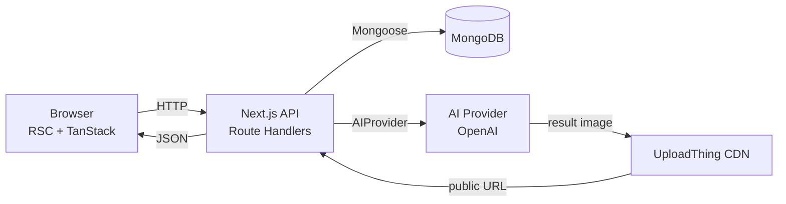

# VirtualFit

> Try on clothes without trying them on.

VirtualFit is a single‑app virtual try‑on platform. Users upload individual garments, upload a portrait, pick an outfit, and the AI generates a photorealistic image of them wearing it. Every generated look is saved to a history gallery.

Built with **Next.js 16 (App Router)**, **MongoDB**, **Auth.js v5**, **UploadThing v7**, **TanStack Query v5**, and a **model‑agnostic AI provider layer** — currently backed by **OpenAI**, designed so any provider can be swapped in with one line.

---

## Table of Contents

- [Features](#features)
- [Tech Stack](#tech-stack)
- [Architecture](#architecture)
- [Project Structure](#project-structure)
- [Prerequisites](#prerequisites)
- [Quick Start](#quick-start)
- [Environment Credentials](#environment-credentials)
- [AI Provider System](#ai-provider-system)
- [Database Schema](#database-schema)
- [API Reference](#api-reference)
- [Scripts](#scripts)
- [Deployment](#deployment)
- [Troubleshooting](#troubleshooting)
- [Security](#security)
- [Roadmap](#roadmap)

---

## Features

### Authentication
- Email/password registration and login (bcrypt + Auth.js v5 credentials provider)
- JWT session strategy with httpOnly cookies
- Route protection via `src/proxy.ts` (Next.js 16 Node runtime — not Edge)
- Per‑request auth guard on every API route

### Wardrobe
- Upload one garment at a time (8 MB, image only)
- AI auto‑tags each item: category, color, style, season, description
- Grid view with delete action (ownership‑checked)
- Items are strictly per‑user

### Portraits
- Upload labeled portraits (label optional)
- AI generates a title when no label is provided
- Same isolation and deletion model as wardrobe

### Virtual Try‑On
- Async job model: `POST /api/try-on` returns `202` with a `jobId`
- Background worker calls the AI provider and updates the job row
- Client polls `GET /api/try-on/[id]` every 3 s until status flips
- Result persisted to UploadThing CDN and saved in `tryonresults`

### History
- List view with status indicators
- Detail page showing result + portrait + garments
- Ownership‑checked at both levels

---

## Tech Stack

| Layer | Choice | Why |
|---|---|---|
| Framework | Next.js 16 (App Router, Turbopack) | Single app, native route handlers, RSC |
| Language | TypeScript (strict) | Type safety across AI payloads & Mongoose models |
| Database | MongoDB + Mongoose | Flexible schema for tags; global connection cache |
| Auth | Auth.js v5 + `@auth/mongodb-adapter` | App Router native, MongoDB session storage |
| Uploads | UploadThing v7 | Type‑safe, CDN‑backed, Next.js native |
| AI | **Provider abstraction** (OpenAI adapter by default) | Swap providers without touching route handlers |
| Client data | TanStack Query v5 + Axios | Cache, polling, optimistic updates |
| Validation | Zod | Shared schemas between client and server |
| UI | Tailwind CSS + `lucide-react` | Consistent design, no runtime CSS‑in‑JS |
| Runtime | Node.js 20+ | Required for `mongodb`, `sharp`, `Buffer`, `crypto.randomUUID` |

---

## Architecture

### High‑level flow



<!-- ### High-level flow

```text
+-------------+      HTTP      +---------------+     Mongoose     +-------------+
|   Browser   |  ----------->  |   Next.js     |  ------------->  |   MongoDB   |
|  RSC +      |                |   API Route   |                  |             |
|  TanStack   |  <-----------  |   Handlers    |  <-------------  |             |
+-------------+      JSON      +-------+-------+                  +-------------+
                                       |
                                       | AIProvider interface
                                       v
                               +---------------+                  +-------------+
                               |  AI Provider  |  ------------->  |   OpenAI    |
                               |  (adapter)    |                  |             |
                               +-------+-------+                  +-------------+
                                       |
                                       | persist image
                                       v
                               +---------------+
                               |  UploadThing  |   <-- returns public URL
                               |     CDN       |
                               +---------------+
``` -->

### Key architectural decisions

**1. No Express, no `next-connect`**

All routes are pure `export const GET/POST = ...` handlers. Auth, DB, and validation are explicit helper calls:

```ts
export const POST = withErrorHandling(async (req) => {
  await connection();
  const { session, response } = await requireAuth();
  if (response) return response;
  // ...
});
```

**2. Async try‑on job model**

AI generation takes 20–90 s. A synchronous route would hit serverless timeouts. The route:

1. Validates ownership
2. Creates a `pending` `TryOnResult`
3. Fires the background worker (fire‑and‑forget)
4. Returns `202 { jobId }`

The client polls with TanStack Query and stops automatically when status is terminal.

**3. Provider abstraction**

Route handlers call `generateTryOn()` / `tagClothing()` from `src/lib/ai/tagging.ts` and `src/lib/ai/try-on.ts`. These delegate to whatever `AIProvider` implementation the `AI_PROVIDER` env var selects. Adding a second provider = one file + one line in `providers/index.ts`.

**4. Next.js 16 Cache Components compatibility**

- Every authenticated route handler begins with `await connection()` (opt out of static prerender)
- Every component that reads `auth()` is wrapped in `<Suspense>` **and** starts with `await connection()`
- `SessionProvider` was removed (nothing calls `useSession()`)

**5. `proxy.ts`, not `middleware.ts`**

Next.js 16 renamed the convention and moved it to the Node runtime, which lets `@auth/mongodb-adapter` resolve `mongodb` without Edge bundling failures.

---

## Project Structure

.
├── docs/
│   ├── content.md
│   └── folder-structure-cmd.md
├── public/
├── src/
│   ├── app/
│   │   ├── (auth)/
│   │   │   ├── layout.tsx
│   │   │   ├── login/page.tsx
│   │   │   └── register/page.tsx
│   │   ├── (dashboard)/
│   │   │   └── dashboard/
│   │   │       ├── layout.tsx
│   │   │       ├── page.tsx                 # Overview
│   │   │       ├── wardrobe/page.tsx
│   │   │       ├── portraits/page.tsx
│   │   │       ├── try-on/page.tsx
│   │   │       └── history/
│   │   │           ├── page.tsx
│   │   │           └── [id]/page.tsx
│   │   ├── api/
│   │   │   ├── auth/
│   │   │   │   ├── [...nextauth]/route.ts
│   │   │   │   └── register/route.ts
│   │   │   ├── portraits/
│   │   │   │   ├── route.ts                 # GET, POST
│   │   │   │   └── [id]/route.ts            # DELETE
│   │   │   ├── try-on/
│   │   │   │   ├── route.ts                 # GET, POST
│   │   │   │   └── [id]/route.ts            # GET
│   │   │   ├── uploadthing/
│   │   │   │   ├── core.ts
│   │   │   │   └── route.ts
│   │   │   └── wardrobe/
│   │   │       ├── route.ts                 # GET, POST
│   │   │       └── [id]/route.ts            # DELETE
│   │   ├── favicon.ico
│   │   ├── globals.css
│   │   ├── layout.tsx
│   │   ├── page.tsx                         # Landing
│   │   └── providers.tsx
│   ├── components/
│   │   ├── auth/
│   │   │   ├── auth-card.tsx
│   │   │   ├── login-form.tsx
│   │   │   ├── login-view.tsx
│   │   │   ├── register-form.tsx
│   │   │   └── register-view.tsx
│   │   ├── features/
│   │   │   ├── history/
│   │   │   ├── overview/
│   │   │   ├── portraits/
│   │   │   ├── try-on/
│   │   │   └── wardrobe/
│   │   ├── layout/
│   │   │   ├── auth-shell.tsx
│   │   │   ├── dashboard-shell.tsx
│   │   │   ├── sidebar.tsx
│   │   │   └── user-menu.tsx
│   │   └── ui/
│   │       ├── button.tsx
│   │       ├── card.tsx
│   │       ├── empty-state.tsx
│   │       ├── input.tsx
│   │       ├── label.tsx
│   │       ├── page-header.tsx
│   │       └── skeleton.tsx
│   ├── config/
│   │   ├── env.ts                            # Zod env validation
│   │   └── site.ts
│   ├── hooks/
│   │   ├── use-clothing.ts
│   │   ├── use-portraits.ts
│   │   └── use-try-on.ts
│   ├── lib/
│   │   ├── ai/
│   │   │   ├── provider.ts                   # Registry + factory
│   │   │   ├── providers/                    # Implementations
│   │   │   ├── tagging.ts
│   │   │   ├── try-on.ts
│   │   │   └── types.ts                      # AIProvider interface
│   │   ├── api/
│   │   │   ├── guards.ts                     # requireAuth()
│   │   │   ├── handler.ts                    # withErrorHandling()
│   │   │   └── response.ts                   # ok(), fail()
│   │   ├── db/
│   │   │   ├── connect.ts                    # Mongoose cache
│   │   │   ├── mongo-client.ts               # Auth.js MongoClient
│   │   │   └── models/
│   │   ├── validators/
│   │   │   ├── auth.ts
│   │   │   ├── clothing.ts
│   │   │   ├── portrait.ts
│   │   │   └── try-on.ts
│   │   ├── api-client.ts                     # Axios instance
│   │   ├── auth.ts                           # NextAuth config
│   │   └── uploadthing.ts
│   ├── types/
│   │   ├── index.ts
│   │   └── next-auth.d.ts
│   └── proxy.ts                              # Route protection
├── .env.example
├── eslint.config.mjs
├── next.config.ts
├── package.json
├── pnpm-lock.yaml
├── pnpm-workspace.yaml
├── tsconfig.json
└── README.md

---

## Prerequisites

- **Node.js** 20+ (LTS recommended)
- **pnpm** 10+
- **MongoDB** running locally or an Atlas cluster
- Accounts on **[OpenAI](https://platform.openai.com)** and **[UploadThing](https://uploadthing.com)**

---

## Quick Start

```bash
# 1. Clone and install
git clone https://github.com/mohammedafjal-lgtm/VirtualFit.git
cd virtualfit
pnpm install

# 2. Configure env
cp .env.example .env.local
# Fill in the values (see Environment Credentials below)

# 3. Ensure MongoDB is running
lsof -i :27017   # macOS/Linux
# or: brew services start mongodb-community

# 4. Start the dev server
pnpm dev
```

Open [http://localhost:3000](http://localhost:3000), register an account, and upload a garment.

---

## Environment Credentials

Copy these values into `.env.local` in your project root. **Never commit that file.**

### Complete `.env.local` template

```env
# MongoDB
MONGODB_URI=mongodb://localhost:27017/virtualfit

# Auth.js
AUTH_SECRET=<openssl rand -base64 32>
AUTH_URL=http://localhost:3000

# UploadThing (v7)
UPLOADTHING_TOKEN=ut_xxxxxxxxxxxxxxxxxxxxxxxx

# AI provider
AI_PROVIDER=openai
OPENAI_API_KEY=sk-xxxxxxxxxxxxxxxxxxxxxxxx
OPENAI_VISION_MODEL=gpt-4o-mini
OPENAI_IMAGE_MODEL=gpt-image-2.5-sunburst
```

### 1. `MONGODB_URI`

**Option A — Local development (simplest)**

If MongoDB is already running on your machine:

```env
MONGODB_URI=mongodb://localhost:27017/virtualfit
```

That is the full value. MongoDB creates the `virtualfit` database automatically on the first write.

**Option B — MongoDB Atlas (cloud)**

1. Sign in at [mongodb.com/atlas](https://www.mongodb.com/atlas).
2. On your cluster, click **Connect**.
3. Choose **Drivers** → **Node.js**.
4. Copy the connection string. It looks like:
   ```
   mongodb+srv://<username>:<password>@cluster0.xxxxx.mongodb.net/?retryWrites=true&w=majority
   ```
5. Insert the database name `virtualfit` before the `?`:

   ```env
   MONGODB_URI=mongodb+srv://<username>:<password>@cluster0.xxxxx.mongodb.net/virtualfit?retryWrites=true&w=majority
   ```

> The same URI is used by both `src/lib/db/mongo-client.ts` (Auth.js adapter) and `src/lib/db/connect.ts` (Mongoose). Keep them pointing at the same database.

### 2. `AUTH_SECRET`

Generate a cryptographically secure random string (at least 32 characters):

```bash
openssl rand -base64 32
```

Or:

```bash
npm exec auth secret
```

Copy the output:

```env
AUTH_SECRET=<paste-the-generated-string>
AUTH_URL=http://localhost:3000
```

`AUTH_SECRET` is the only strictly required Auth.js environment variable — it is used to encrypt cookies and tokens.

### 3. `UPLOADTHING_TOKEN`

1. Sign up or log in at [uploadthing.com](https://uploadthing.com).
2. Create a new app.
3. In the dashboard, go to **API Keys**.
4. Select the **V7** tab.
5. Click **Quick Copy** to copy the full `UPLOADTHING_TOKEN` environment variable.

```env
UPLOADTHING_TOKEN=ut_xxxxxxxxxxxxxxxxxxxxxxxx
```

In UploadThing v7, the token is a single base64‑encoded JSON object that replaces the old `UPLOADTHING_SECRET` and contains your app ID, region, and API key.

### 4. `OPENAI_API_KEY`

1. Sign in at [platform.openai.com](https://platform.openai.com).
2. Go to the API keys page: [platform.openai.com/api-keys](https://platform.openai.com/api-keys).
3. Click **Create new secret key**.
4. Copy the key immediately — it is shown only once and starts with `sk-`.

```env
OPENAI_API_KEY=sk-xxxxxxxxxxxxxxxxxxxxxxxx
AI_PROVIDER=openai
OPENAI_VISION_MODEL=gpt-4o-mini
OPENAI_IMAGE_MODEL=gpt-image-2.5-sunburst
```

> **Billing note:** A ChatGPT Plus subscription does not fund API usage. If your API account has no free credits, add a prepaid balance before making your first request.

---

## AI Provider System

VirtualFit does not hard‑code any AI SDK into route handlers. All calls go through the `AIProvider` interface in `src/lib/ai/types.ts`:

```ts
export interface AIProvider {
  readonly name: string;
  tagClothing(imageUrl: string): Promise<ClothingTags>;
  generatePortraitTitle(imageUrl: string): Promise<string>;
  generateTryOn(input: TryOnInput): Promise<TryOnOutput>;
}
```

### Adding a new provider

1. Create `src/lib/ai/providers/<name>.ts` implementing `AIProvider`.
2. Register it in `src/lib/ai/providers/index.ts`:

   ```ts
   registerProvider("flux", () => new FluxProvider());
   ```

3. Switch via env:

   ```env
   AI_PROVIDER=flux
   ```

No route handlers change. No client code changes.

### Current adapters

| Provider | Tagging | Try‑on | Notes |
|---|---|---|---|
| `openai` | `gpt-4o-mini` (Responses API) | `gpt-image-2.5-sunburst` (Images Edit) | Default; accepts up to 16 images per call |

---

## Database Schema

### `users`

```ts
{ _id, email, name, password (bcrypt), image, createdAt, updatedAt }
```

### `clothingitems`

```ts
{
  _id, userId, imageUrl, name?,
  tags: { category, color, style, season, description },
  createdAt, updatedAt
}
```

### `portraits`

```ts
{ _id, userId, imageUrl, name, createdAt, updatedAt }
```

### `tryonresults`

```ts
{
  _id, userId, portraitId, clothingIds[],
  resultUrl?, status: "pending" | "completed" | "failed",
  error?, createdAt, updatedAt
}
```

### Indexes

- `clothingitems.{ userId: 1, createdAt: -1 }`
- `portraits.{ userId: 1, createdAt: -1 }`
- `tryonresults.{ userId: 1, createdAt: -1 }`

---

## API Reference

All endpoints require authentication (session cookie) and return JSON.

| Method | Path | Purpose |
|---|---|---|
| `POST` | `/api/auth/register` | Create account |
| `GET` `POST` | `/api/auth/[...nextauth]` | Auth.js handlers |
| `GET` | `/api/wardrobe` | List user's clothing |
| `POST` | `/api/wardrobe` | Create clothing item (runs AI tagging) |
| `DELETE` | `/api/wardrobe/:id` | Delete owned clothing item |
| `GET` | `/api/portraits` | List user's portraits |
| `POST` | `/api/portraits` | Create portrait (AI title if no name) |
| `DELETE` | `/api/portraits/:id` | Delete owned portrait |
| `GET` | `/api/try-on` | List user's try‑on history |
| `POST` | `/api/try-on` | Create try‑on job → `202 { jobId }` |
| `GET` | `/api/try-on/:id` | Poll job status |
| `GET` `POST` | `/api/uploadthing` | UploadThing handler |

### Error format

```json
{ "error": "message" }
```

Validation errors (400) return a Zod `flatten()` object.

---

## Scripts

```bash
pnpm dev          # Start dev server (Turbopack)
pnpm build        # Production build
pnpm start        # Run production build
pnpm lint         # ESLint
pnpm typecheck    # tsc --noEmit
```

---

## Deployment

### Vercel (recommended)

1. Push the repo to GitHub.
2. Import in Vercel.
3. Set all env vars in **Project Settings → Environment Variables**.
4. Use MongoDB **Atlas** (not `localhost`) — Vercel cannot reach your local `mongod`.
5. Deploy.

### Platform notes

- **Runtime must be Node.js**, not Edge — `mongodb`, `bcryptjs`, and `Buffer` require it
- Set function timeout to **60 s or more** for the try‑on route (AI generation is slow)
- Use **separate** MongoDB databases for staging and production
- Rotate `AUTH_SECRET` and `OPENAI_API_KEY` on a schedule
- Persist generated try‑on images to a CDN (UploadThing or S3/R2) — not local disk

### Pre‑deploy checklist

- [ ] `pnpm typecheck` passes
- [ ] `pnpm build` passes without prerender warnings
- [ ] `.env.local` is **not** in git history
- [ ] All env vars are set in the platform dashboard
- [ ] MongoDB IP allowlist includes the platform's egress IPs (or `0.0.0.0/0` for serverless)
- [ ] OpenAI account has billing credit
- [ ] UploadThing app is on V7

---

## Troubleshooting

| Symptom | Likely cause | Fix |
|---|---|---|
| `MongooseServerSelectionError` | MongoDB down or IP not whitelisted | Start `mongod` or whitelist the IP |
| `Missing environment variable: "MONGODB_URI"` | Env file not loaded | File must be `.env.local`; restart `pnpm dev` |
| `Auth.js: Missing secret` | `AUTH_SECRET` empty or short | Regenerate with `openssl rand -base64 32` |
| `Upload returned no URL` | UploadThing token from wrong tab | Copy the **V7** token |
| `402 Payment Required` (OpenAI) | No billing credit | Add credit at `platform.openai.com/account/billing` |
| `Unknown AI_PROVIDER` | Registry not imported | Confirm `import "./providers"` at top of `tagging.ts` and `try-on.ts` |
| `Module not found: 'mongodb'` | `mongodb` package missing | `pnpm add mongodb` |
| `crypto.getRandomValues()` prerender error | `auth()` outside Suspense | `await connection()` as first line of the child component |
| `405 Method Not Allowed` on a GET route | Missing `GET` export | Add `export const GET = ...` to that `route.ts` |
| Prerender error with `headers()` | GET route treated as static | `await connection()` at top of the handler |

---

## Security

- `.env.local` must be in `.gitignore` — verify with `git check-ignore .env.local`
- `AUTH_SECRET` must be **random 32+ bytes**, never a passphrase
- Every `find` / `findOne` / `deleteOne` **must** include `userId` from the session — this is the ownership layer
- Tokens (`OPENAI_API_KEY`, `UPLOADTHING_TOKEN`) must be server‑only — no `NEXT_PUBLIC_` prefix
- OpenAI images are handled server‑side — never trust a client‑sent URL to be a user's own asset
- Rate‑limit AI endpoints before opening to the public (e.g., Upstash, Vercel KV)
- Sanitize error messages before returning to the client — never leak stack traces

### Reporting

Found a security issue? Email **security@your-domain** instead of opening a public issue.

---

## Roadmap

- [ ] Pagination for wardrobe / portraits / history
- [ ] Retry action on failed try‑on jobs
- [ ] Bulk clothing upload
- [ ] Saved outfit presets
- [ ] Image preprocessing (resize before AI call — cuts cost)
- [ ] Shareable try‑on links
- [ ] Rate limiting on AI endpoints
- [ ] E2E tests (Playwright)
- [ ] Additional AI providers (Flux, Gemini)

---

## License

MIT